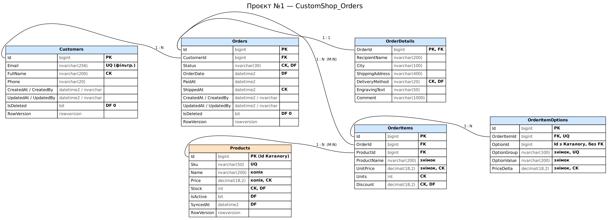
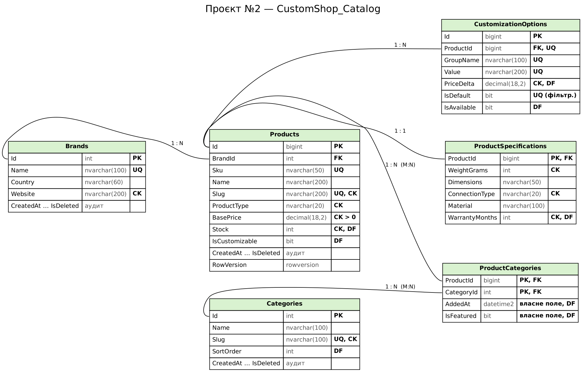

# CustomShop — бази даних для мікросервісної архітектури (Лаб. 01)

Практичне заняття №1: три самостійні бази даних інтернет-магазину кастомних комп'ютерних аксесуарів.

## 1. Предметна область

Інтернет-магазин кастомних комп'ютерних аксесуарів: клавіатур, мишей, навушників, колонок і килимків. Покупець обирає базовий товар і налаштовує його (тип світчів, кейкапи, колір корпусу, амбушури, принт килимка), оформлює замовлення, яке магазин виготовляє та відвантажує. Після покупки клієнти залишають відгуки та публікують фото своїх сетапів у галереї.

## 2. Контексти (Bounded Contexts)

| Контекст | Проєкт / технологія | БД | Сутності, якими володіє лише цей контекст | Чужі дані (лише Id або копія, не власник) |
|---|---|---|---|---|
| **Замовлення** | №1 — SQL Server + ADO.NET & Dapper | `CustomShop_Orders` | Customer, Order, OrderDetails, OrderItem, OrderItemOption | таблиця `Products` — локальна копія (read model) товарів Каталогу; `OrderItemOptions.OptionId` → опція Каталогу |
| **Каталог** | №2 — SQL Server + EF Core | `CustomShop_Catalog` | Brand, Category, Product, ProductCategory, ProductSpecification, CustomizationOption | — |
| **Відгуки та галерея** | №3 — MongoDB | `customshop_reviews` | UserProfile (`userProfiles`), Review (`reviews`), Discussion (`discussions`), Build (`builds`) | `productId`, `productName` → Каталог; `orderId`, `customerId` → Замовлення |

**Product** належить лише Каталогу: таблиця `Products` у БД Замовлень — це не окрема сутність, а локальна копія потрібних для оформлення полів (Sku, Name, Price, Stock, IsActive), яку оновлюють події з Каталогу (див. політику дублювання). Замовлення ці дані не створюють і не редагують як власник — лише резервують склад у межах свого сервісу.

Кожна сутність має одного власника. Інші контексти зберігають лише її ідентифікатор і, за потреби, знімок окремих полів. Між базами немає спільних таблиць і жодного FOREIGN KEY: посилання на сутність іншого контексту — звичайний стовпець/поле з її Id (`Products.Id`, `OrderItemOptions.OptionId` у БД Замовлень; `productId`, `orderId`, `customerId` у MongoDB). Усі FOREIGN KEY в `db/p1/schema.sql` і `db/p2/schema.sql` посилаються лише на таблиці своєї бази.

## 3. Агрегати

| Контекст | Агрегат (корінь + пов'язані об'єкти) | Життєвий цикл |
|---|---|---|
| Замовлення | **Order** + OrderDetails + OrderItems + OrderItemOptions | позиції та опції не існують без замовлення, змінюються лише через нього (процедури); видалення замовлення каскадно видаляє їх |
| Замовлення | **Customer** | м'яке видалення; фізично не видаляється, поки є історія замовлень |
| Каталог | **Product** + ProductSpecification + CustomizationOptions (+ зв'язки ProductCategories) | специфікація та опції каскадно видаляються разом із товаром |
| Каталог | **Brand**, **Category** | довідники |
| Відгуки | **Review** + вбудовані author, comments, customization | коментарі живуть у відгуку |
| Відгуки | **Discussion** (+ вбудовані messages) | посилається на відгук, може бути дуже великою |
| Відгуки | **Build** (+ вбудований масив items) | знімок сетапу на момент публікації |
| Відгуки | **UserProfile** | публічний профіль, пов'язаний з Customer через customerId |

### Статуси замовлення

```
Submitted → AwaitingValidation → StockConfirmed → Paid → InProduction → Shipped
    └──────────────┴────────────────────┴──→ Cancelled   (лише до оплати)
```

`InProduction` — етап виготовлення кастомного товару (відмінність від eShop).

## 4. Політика дублювання даних

| Поле | Де зберігається | Джерело (власник) | Політика узгодженості |
|---|---|---|---|
| `OrderItems.ProductName`, `UnitPrice` | БД Замовлень | Product (БД Каталогу) | знімок на момент оформлення — не оновлюється |
| `OrderItemOptions.OptionId`, `OptionGroup`, `OptionValue`, `PriceDelta` | БД Замовлень | CustomizationOption (БД Каталогу) | знімок на момент оформлення — не оновлюється |
| `Products.Sku`, `Name`, `Price`, `Stock`, `IsActive` (локальна копія) | БД Замовлень | Product (БД Каталогу) | оновлюється подіями з Каталогу (`ProductCreated`, `ProductUpdated`, `StockChanged`); `SyncedAt` — час останньої події |
| `reviews.productName`, `productType` | MongoDB | Product (БД Каталогу) | оновлюється подіями з Каталогу (`onProductRenamed` у `queries.js`) |
| `discussions.productId`, `reviews.productId`, `builds.items[].productId` | MongoDB | Product (БД Каталогу) | лише ідентифікатор, без FK |
| `builds.items[].productName`, `productType` | MongoDB | Product (БД Каталогу) | знімок на момент публікації сетапу — не оновлюється |
| `reviews.verifiedPurchase`, `reviews.orderId` | MongoDB | Order (БД Замовлень) | встановлюється подією `OrderShipped` (`onOrderShipped`) |
| `userProfiles.customerId` | MongoDB | Customer (БД Замовлень) | лише ідентифікатор, без FK; профіль створюється подією `CustomerRegistered` |
| `reviews.author.displayName`, `builds.author.displayName`, `discussions.messages[].author.displayName` | MongoDB | userProfiles (та сама БД) | денормалізація для читання; оновлюється `updateMany` при зміні профілю (`onProfileRenamed`) |

Пари контекстів, що взаємодіють: **Каталог ↔ Замовлення**, **Каталог ↔ Відгуки**, **Замовлення ↔ Відгуки** — для кожної є щонайменше один рядок.

## 5. Ключі, конкурентність, аудит

**Первинні ключі**

- `BIGINT IDENTITY` для Customers, Orders, OrderItems (Проєкт №1) і Products, CustomizationOptions (Проєкт №2). Записи створює один сервіс, тож центрального генератора не потрібно; послідовні ключі дають компактний кластерний індекс без фрагментації.
- `INT IDENTITY` для малих довідників Brands і Categories.
- `Products.Id` у БД Замовлень **не** IDENTITY: це той самий Id, що в Каталозі.
- `OrderItems` має сурогатний PK, а не `(OrderId, ProductId)`: в одному замовленні може бути той самий товар двічі з різними налаштуваннями.
- MongoDB: `ObjectId` генерується клієнтом без координації між вузлами і впорядкований за часом.

**Каскади.** `ON DELETE CASCADE` — лише для частин агрегату (OrderDetails, OrderItems, OrderItemOptions, ProductSpecifications, ProductCategories, CustomizationOptions). Customers → Orders і Brands → Products — без каскаду: клієнта з історією замовлень чи бренд із товарами видалити не можна.

**Аудит і м'яке видалення.** `CreatedAt`, `CreatedBy`, `UpdatedAt`, `UpdatedBy`, `IsDeleted` у Customers, Orders, Brands, Categories, Products. Фільтровані індекси (`WHERE IsDeleted = 0`) працюють лише з «живими» записами.

**Оптимістична конкурентність — `ROWVERSION`:**

- `Orders` — статус одночасно можуть змінювати менеджер і платіжний сервіс;
- `Customers` — профіль редагують клієнт і підтримка;
- `Products` (обидві SQL-бази) — ціну та склад змінюють менеджер, резервування замовлень і обробник подій.

Процедури приймають `@ExpectedRowVersion`: якщо запис уже змінив інший користувач, повертається помилка 50003 замість «тихого» перезапису. В EF Core (Лаб. 03) це властивість з `.IsRowVersion()`.

## 6. ERD

Проєкт №1 — `CustomShop_Orders` (M:N Orders ↔ Products через OrderItems):



Проєкт №2 — `CustomShop_Catalog` (M:N Products ↔ Categories через ProductCategories з власними полями `AddedAt`, `IsFeatured`):



Вихідні файли для [dbdiagram.io](https://dbdiagram.io/d): `docs/erd/project1_orders.dbml`, `docs/erd/project2_catalog.dbml` (вставити вміст у редактор). SVG-версії лежать поруч.

## 7. Структура репозиторію

```
<корінь>/
├── README.md                     опис домену, запуск, розгортання БД, таблиця дублювання
├── docs/
│   ├── contexts.md               предметна область, контексти, агрегати
│   ├── duplication-policy.md     таблиця політики дублювання
│   ├── mongodb-model.md          структура колекцій MongoDB
│   ├── sample-documents.json     приклади документів (Extended JSON)
│   └── erd/                      ERD (png, svg, dbml)
└── db/
    ├── README.md                 порядок запуску скриптів
    ├── docker-compose.yml        SQL Server 2022 + MongoDB 7
    ├── deploy.ps1                розгортання однією командою (Windows)
    ├── deploy.sh                 розгортання однією командою (Linux/macOS)
    ├── p1/                       Проєкт №1 — SQL Server + ADO.NET & Dapper
    │   ├── schema.sql            таблиці, ключі, обмеження, індекси, view
    │   ├── procedures.sql        6 збережуваних процедур
    │   ├── seed.sql              тестові дані (ідемпотентний)
    │   └── checks.sql            CRUD, пошук, пагінація, транзакційні сценарії
    ├── p2/                       Проєкт №2 — SQL Server + EF Core
    │   ├── schema.sql
    │   ├── seed.sql              довідникові дані (ідемпотентний)
    │   └── checks.sql
    └── p3/                       Проєкт №3 — MongoDB
        ├── collections.js        колекції + JSON Schema Validation + індекси
        ├── seed.js               тестові дані (ідемпотентний)
        └── queries.js            запити, aggregation pipeline, обробники подій
```

## 8. Розгортання з нуля

### Швидкий старт: одна команда (рекомендовано)

Потрібен лише [Docker Desktop](https://www.docker.com/products/docker-desktop/). Скрипт сам підніме SQL Server і MongoDB з `db/docker-compose.yml`, дочекається їхньої готовності й виконає всі скрипти в правильному порядку.

**Windows (PowerShell), з кореня репозиторію:**

```powershell
.\db\deploy.ps1 -Docker            # розгорнути всі три бази
.\db\deploy.ps1 -Docker -Checks    # + запити перевірки (checks.sql, queries.js)
.\db\deploy.ps1 -Docker -SeedOnly  # повторний seed — перевірка ідемпотентності
```

Якщо PowerShell блокує запуск скриптів: `powershell -ExecutionPolicy Bypass -File .\db\deploy.ps1 -Docker`.

**Linux / macOS / Git Bash:**

```bash
./db/deploy.sh --docker
./db/deploy.sh --docker --checks
./db/deploy.sh --docker --seed-only
```

Після розгортання бази доступні з хоста: SQL Server — `localhost,1433` (логін `sa`, пароль `Str0ng!Passw0rd`), MongoDB — `mongodb://localhost:27017`. Підключитися можна з SSMS / Azure Data Studio / MongoDB Compass.

Зупинити контейнери: `docker compose -f db/docker-compose.yml down` (дані зберігаються). Повністю очистити: `... down -v`.

**Без Docker** (SQL Server і MongoDB уже встановлені локально, є `sqlcmd` і `mongosh`):

```powershell
.\db\deploy.ps1                                  # логін sa, пароль зі змінної SQL_PASSWORD
.\db\deploy.ps1 -Trusted                         # Windows-автентифікація
.\db\deploy.ps1 -SqlServer "localhost\SQLEXPRESS" -Trusted -Projects p1,p2
```

| Параметр PowerShell | Bash | Що робить |
|---|---|---|
| `-Docker` | `--docker` | запускає `db/docker-compose.yml` і виконує скрипти в контейнерах |
| `-Projects p1,p3` | `p1 p3` | лише вибрані бази |
| `-Checks` | `--checks` | після seed виконує `checks.sql` / `queries.js` |
| `-SeedOnly` | `--seed-only` | лише seed (схема не перестворюється) |
| `-Trusted` | `SQL_TRUSTED=1` | Windows-автентифікація |
| `-SqlServer`, `-SqlPassword`, `-MongoUri` | `SQL_SERVER`, `SQL_PASSWORD`, `MONGO_URI` | параметри підключення |

### Ручне розгортання (покроково)

### Що потрібно

- SQL Server 2019+ (локально або в Docker) і SSMS / Azure Data Studio, або утиліта `sqlcmd`;
- MongoDB 6+ і `mongosh`.

Запуск у Docker (необов'язково):

```bash
docker run -d --name customshop-sql -e "ACCEPT_EULA=Y" -e "MSSQL_SA_PASSWORD=Str0ng!Passw0rd" \
  -p 1433:1433 mcr.microsoft.com/mssql/server:2022-latest
docker run -d --name customshop-mongo -p 27017:27017 mongo:7
```

### Проєкт №1 — CustomShop_Orders

Через SSMS: відкрити файл → **Execute (F5)** у такому порядку:

1. `db/p1/schema.sql` — створює БД `CustomShop_Orders`, таблиці, індекси, view;
2. `db/p1/procedures.sql` — 6 процедур;
3. `db/p1/seed.sql` — тестові дані;
4. `db/p1/checks.sql` — перевірка.

Через `sqlcmd` (з кореня репозиторію):

```bash
sqlcmd -S localhost -U sa -P "Str0ng!Passw0rd" -C -I -f 65001 -i db/p1/schema.sql
sqlcmd -S localhost -U sa -P "Str0ng!Passw0rd" -C -I -f 65001 -i db/p1/procedures.sql
sqlcmd -S localhost -U sa -P "Str0ng!Passw0rd" -C -I -f 65001 -i db/p1/seed.sql
sqlcmd -S localhost -U sa -P "Str0ng!Passw0rd" -C -I -f 65001 -i db/p1/checks.sql
```

- `-f 65001` — читати файли як UTF-8 (інакше кирилиця зіпсується);
- `-I` — увімкнути QUOTED_IDENTIFIER (потрібно для фільтрованих індексів; у скриптах це також задано явно);
- `-C` — довіряти сертифікату сервера (локальний Docker);
- з Windows-автентифікацією замість `-U … -P …` використовуйте `-E`.

> `schema.sql` перестворює таблиці, тобто видаляє наявні дані. `seed.sql` можна запускати скільки завгодно разів — дублікатів не буде.

### Проєкт №2 — CustomShop_Catalog

```bash
sqlcmd -S localhost -U sa -P "Str0ng!Passw0rd" -C -I -f 65001 -i db/p2/schema.sql
sqlcmd -S localhost -U sa -P "Str0ng!Passw0rd" -C -I -f 65001 -i db/p2/seed.sql
sqlcmd -S localhost -U sa -P "Str0ng!Passw0rd" -C -I -f 65001 -i db/p2/checks.sql
```

Цей DDL — проєкт схеми. У Лаб. 03 її відтворюють сутностями EF Core з Fluent API і застосовують міграціями:

```bash
dotnet ef migrations add InitialCatalog
dotnet ef database update
```

Імена ключів та індексів у `schema.sql` відповідають конвенціям EF Core, а seed-дані переносяться в `HasData(...)`. Наступні зміни структури — нові міграції (`dotnet ef migrations add <Опис>`).

### Проєкт №3 — customshop_reviews (MongoDB)

```bash
mongosh "mongodb://localhost:27017" db/p3/collections.js
mongosh "mongodb://localhost:27017" db/p3/seed.js
mongosh "mongodb://localhost:27017" db/p3/queries.js
```

Для Docker без локального `mongosh`:

```bash
docker cp db/p3 customshop-mongo:/scripts
docker exec -it customshop-mongo mongosh /scripts/collections.js
docker exec -it customshop-mongo mongosh /scripts/seed.js
docker exec -it customshop-mongo mongosh /scripts/queries.js
```

`collections.js` і `seed.js` безпечно запускати повторно: валідатори оновлюються через `collMod`, документи вставляються через upsert з фіксованими `_id`.

## 9. Збережувані процедури (Проєкт №1)

| Процедура | Тип | Що робить |
|---|---|---|
| `usp_UpsertCustomer` | CRUD (C/U) | створює або оновлює клієнта; перевірка унікальності email і `RowVersion` |
| `usp_DeleteCustomer` | CRUD (D) | м'яке видалення; відмова, якщо є незавершені замовлення |
| `usp_GetCustomerOrders` | CRUD (R) | замовлення клієнта з фільтром статусу і пагінацією |
| `usp_CreateOrder` | транзакція | замовлення + деталі доставки (1:1) атомарно |
| `usp_AddOrderItem` | транзакція | позиція зі знімком назви/ціни та обраних опцій (JSON) |
| `usp_ChangeOrderStatus` | транзакція | перехід статусу з перевіркою допустимості; резервування складу при `StockConfirmed`, повернення при скасуванні |

Підтвердження замовлення (`usp_ConfirmOrder` з методички) — це виклик `usp_ChangeOrderStatus @NewStatus = 'StockConfirmed'`.

Приклад недопустимого переходу:

```sql
EXEC dbo.usp_ChangeOrderStatus @OrderId = 4, @NewStatus = N'Shipped';
-- Msg 50002: Invalid status transition: Submitted -> Shipped   (дія не виконується)
```

Коди керованих помилок перелічено на початку `procedures.sql`. Кожна процедура зі зміною даних має шаблон `BEGIN TRY / BEGIN TRANSACTION … COMMIT / END TRY / BEGIN CATCH: ROLLBACK; THROW; END CATCH`: при відмові транзакцію відкочено всередині процедури, а викликач (ADO.NET / Dapper) отримує `SqlException` з тим самим номером 5000x.

## 10. MongoDB: структура колекцій

| Колекція | Embedding | Referencing | Гнучка схема |
|---|---|---|---|
| `userProfiles` | `socials`, `stats` | `customerId` → БД Замовлень | `bio`, `socials`, `avatarUrl` є не в усіх |
| `reviews` | `author`, `comments[]`, `customization` | `productId` → Каталог, `orderId` → Замовлення, `discussionId` → discussions, `author.profileId` → userProfiles | `photos`, `pros`, `cons`, `title`, ключі `customization` різні |
| `discussions` | `messages[]` з вбудованим автором | `reviewId` → reviews | повідомлення з профілем і без |
| `builds` | `items[]` з `customization`, `author` | `items[].productId` → Каталог, `author.profileId` → userProfiles | у кожного типу товару свої поля налаштувань |

**Гібридний підхід:** автор у `reviews` / `builds` = посилання (`profileId`) + знімок імені (`displayName`). Короткі коментарі вбудовані у відгук (обмеження `maxItems: 50`), а довге обговорення винесене в `discussions` за посиланням.

## 11. Чек-лист перед здачею

- [ ] `SELECT * FROM sys.foreign_keys` у кожній SQL-базі показує лише таблиці цієї бази (`checks.sql`, блок 1).
- [ ] Недопустимий перехід (`Submitted → Shipped`, скасування оплаченого) повертає помилку 50002 і не змінює статус (`checks.sql`, блок 5).
- [ ] `db.reviews.find()` повертає документи з різними наборами полів (`queries.js`, розділ 1).
- [ ] Повторний запуск `seed.sql` / `seed.js` не змінює кількість записів.
- [ ] Поля зі знімками (`OrderItems.ProductName`, `UnitPrice`, `OrderItemOptions.*`, `builds.items[].productName`) задокументовані в DDL та в таблиці розділу 4.

## 12. Відповідність критеріям

| Критерій | Де виконано |
|---|---|
| Предметна область і три незалежні контексти з сутностями | розділи 1–3 цього README, `docs/contexts.md` |
| Таблиця політики дублювання | розділ 4 цього README, `docs/duplication-policy.md` |
| Три самостійні бази без FOREIGN KEY між ними | `db/p1/schema.sql`, `db/p2/schema.sql` (FK лише всередині своєї бази), розділ 2 README, `docs/duplication-policy.md` |
| Проєкт №1: 4+ таблиць зі зв'язками 1:1, 1:N, M:N | `db/p1/schema.sql`: 1:1 Orders ↔ OrderDetails (PK = FK), 1:N Customers → Orders, M:N Orders ↔ Products через OrderItems (два FK) |
| Ключі, обмеження й індекси під конкретні запити | `db/p1/schema.sql`: PK, FK, UNIQUE, CHECK, DEFAULT, усвідомлені каскади; над кожним індексом коментар із запитом |
| Аудит, м'яке видалення, оптимістична конкурентність | `db/p1/schema.sql`: CreatedAt/CreatedBy/UpdatedAt/UpdatedBy/IsDeleted, ROWVERSION у Customers, Orders, Products |
| 4–6 процедур, транзакційна зміна статусу | `db/p1/procedures.sql`: 6 процедур (3 CRUD + 3 бізнес-операції); `usp_ChangeOrderStatus` — явна транзакція `BEGIN TRANSACTION … COMMIT`, на недопустимому переході `THROW 50002`, у `CATCH` — `ROLLBACK` і повторний `THROW` |
| Проєкт №2: 4–6 сутностей, усі зв'язки, M:N з власним полем | `db/p2/schema.sql` (6 таблиць, ProductCategories з `AddedAt`, `IsFeatured`), `db/p2/seed.sql` |
| MongoDB: 3–4 колекції, embedding, referencing, гібрид | `db/p3/collections.js`, `db/p3/seed.js`, `docs/mongodb-model.md`, `docs/sample-documents.json` |
| Ідемпотентні seed-скрипти | `db/p1/seed.sql`, `db/p2/seed.sql` (`WHERE NOT EXISTS`), `db/p3/seed.js` (upsert за `_id`) |
| Скрипти розгортання, README з порядком запуску й ERD | `db/deploy.ps1`, `db/deploy.sh`, `db/docker-compose.yml`; окремі `schema.sql` / `procedures.sql` / `seed.sql` / `collections.js` / `seed.js`; розділи 6 і 8 цього README, `db/README.md`, `docs/erd/` |


---

# Лаб. 02 — шарувата архітектура мікросервісу «Замовлення» (ASP.NET Core, ADO.NET + Dapper, Aspire)

Реалізація контексту «Замовлення» поверх БД `CustomShop_Orders` з Лаб. 01. Рішення — `Platform.slnx`.

## Структура

```
Platform.slnx                     одне рішення на всю платформу
Platform.AppHost/                 оркестрація Aspire (AppHost.cs)
Services/Orders/
  Orders.Api/                     контролери, Program.cs, appsettings.json, глобальний обробник помилок
  Orders.Bll/                     сервіси, DTO, AutoMapper-профіль, валідація (Validation/)
  Orders.Dal/                     репозиторії (Dapper + чистий ADO.NET), Unit of Work, IDbSession
  Orders.Domain/                  моделі, статуси замовлення, доменні винятки
db/  docs/                        Лаб. 01
```

Залежності: `Api → Bll → Dal → Domain` (Bll також бачить Domain).

| Що | Де |
|---|---|
| `IGenericRepository<T>` + спеціалізовані інтерфейси | `Orders.Dal/Abstractions/` |
| Репозиторій на чистому ADO.NET (`SqlCommand` + `SqlDataReader`) | `Orders.Dal/Repositories/OrderSummaryRepository.cs` |
| Репозиторії на Dapper зі спільною базою `BaseDapperRepository<T>` | `CustomerRepository`, `ProductRepository`, `OrderRepository` (multi-mapping, `usp_CreateOrder`, `usp_ChangeOrderStatus`), `OrderItemRepository` |
| Усі SQL-запити параметризовані; ідентифікатори таблиць/стовпців лише з коду й перевіряються `SqlBuilder` | `Orders.Dal/Infrastructure/SqlBuilder.cs` |
| Unit of Work: одне з'єднання й транзакція на всі репозиторії (Scoped) | `UnitOfWork.cs`, `DbSession.cs` |
| Помилки SQL Server → доменні винятки (`50001…50012`, `547`, `2601/2627`) | `SqlExceptionTranslator.cs` |
| Транзакційна операція через кілька репозиторіїв (знімок назви й ціни) | `OrderService.PlaceAsync` |
| Валідація: DataAnnotations на DTO + бізнес-правила в BLL | `Dtos/`, `Validation/` |
| NotFound → 404, BusinessConflict → 409, Validation → 400, решта → 500 (ProblemDetails + `traceId`) | `Orders.Api/Middleware/DomainExceptionHandler.cs` |

## Запуск через Aspire

Потрібні .NET 9 SDK і запущений Docker Desktop (Aspire сам піднімає контейнер SQL Server; контейнери з Лаб. 01 для цього запускати не потрібно):

```bash
dotnet run --project Platform.AppHost --launch-profile http
```

AppHost (`Platform.AppHost/AppHost.cs`) оркеструє:

| Ресурс | Що це |
|---|---|
| `sql` | SQL Server 2022 у контейнері з постійним volume `customshop-orders-sql`: дані переживають перезапуск AppHost; пароль SA зафіксований в `AppHost.cs` (параметр `sql-password`) |
| `OrdersDb` | база `CustomShop_Orders` на цьому сервері; щойно вона готова, AppHost виконує `db/p1/schema.sql → procedures.sql → seed.sql` (`DatabaseInitializer.cs`) — лише якщо таблиці `Orders` ще немає, тому наявні дані не перезаписуються |
| `orders-api` | `Orders.Api`; отримує рядок підключення через `WithReference(ordersDb)` як `ConnectionStrings__OrdersDb`, стартує після готовності БД (`WaitFor`), health check — `/health` |

У консолі з'явиться посилання на **Aspire Dashboard** (http://localhost:15170, токен — у посиланні): ресурси `sql`, `OrdersDb` і `orders-api` мають перейти у стан **Running**, health check `orders-api` — **Healthy**. URL API беріть із Dashboard; Swagger — `<url>/swagger`.

Контейнер SQL Server одноразовий: Aspire зупиняє й видаляє його при завершенні AppHost, а наступний запуск створює новий і підключає той самий volume — дані зберігаються. Щоб повернути початковий стан: зупиніть AppHost, виконайте `docker volume rm customshop-orders-sql` і запустіть знову.

Без Aspire: підніміть SQL Server з Лаб. 01 (`docker compose -f db/docker-compose.yml up -d`, `db/deploy.ps1`) і запустіть `dotnet run --project Services/Orders/Orders.Api` (рядок підключення — `ConnectionStrings:OrdersDb` в `Services/Orders/Orders.Api/appsettings.json`, перевизначається змінною середовища `ConnectionStrings__OrdersDb`; Swagger: http://localhost:5080/swagger).

## Приклади запитів

```bash
API=http://localhost:5080   # з Aspire — адреса orders-api з Dashboard

curl $API/api/customers/1
curl "$API/api/customers/1/orders?status=Shipped&page=1&pageSize=5"
curl "$API/api/products?page=1&pageSize=3"
curl $API/api/orders/statistics

# оформлення замовлення (201 + Location)
curl -i -X POST $API/api/orders -H "Content-Type: application/json" -d '{
  "customerId": 1,
  "delivery": { "recipientName": "Test Person", "phone": "+380671112233", "city": "Kyiv",
                "shippingAddress": "Test str 1", "deliveryMethod": "NovaPoshta" },
  "items": [ { "productId": 1, "units": 1, "discount": 0,
               "options": [ { "optionId": 2, "group": "Світчі", "value": "Holy Panda", "priceDelta": 900 } ] } ]
}'

# зміна статусу; rowVersion (необов'язково) — значення з останньої відповіді API
curl -X POST $API/api/orders/5/status -H "Content-Type: application/json" -d '{"newStatus":"AwaitingValidation"}'

# SQL-ін'єкція не проходить: апостроф зберігається як звичайний текст
curl -X POST $API/api/customers -H "Content-Type: application/json" \
  -d "{\"email\":\"o.brien@example.com\",\"fullName\":\"Patrick O'Brien'; DROP TABLE Customers;--\"}"
```

Очікувані помилки (ProblemDetails):

| Запит | Код |
|---|---|
| `GET /api/orders/999999` | 404 |
| недопустимий перехід статусу (`Submitted → Shipped`), нестача товару на складі, дубль email, застарілий `rowVersion` | 409 |
| порожній список позицій, некоректні дані | 400 |

## Ендпоїнти

| Метод і шлях | Опис |
|---|---|
| `GET/POST /api/customers`, `GET/PUT/DELETE /api/customers/{id}` | CRUD покупців (`usp_UpsertCustomer`, `usp_DeleteCustomer`, RowVersion у `PUT`) |
| `GET /api/customers/{id}/orders` | замовлення клієнта зі статусом-фільтром і пагінацією (ADO.NET, `usp_GetCustomerOrders`) |
| `GET/POST /api/products`, `GET/PUT/DELETE /api/products/{id}` | локальна копія довідника товарів |
| `POST /api/orders`, `GET /api/orders/{id}` | оформлення замовлення в одній транзакції; перегляд із покупцем, доставкою, позиціями й опціями |
| `POST /api/orders/{id}/status` | зміна статусу (`usp_ChangeOrderStatus`: переходи, склад, RowVersion) |
| `GET /api/orders/statistics` | кількість і сума замовлень за статусами (`vw_OrderSummary`) |

---

# Лаб. 03 — мікросервіс «Каталог» на EF Core (Code-First)

Проєкт №2 з Лаб. 01: та сама схема `CustomShop_Catalog`, але тепер її створюють міграції з моделей. Структура шарів — як у Лаб. 02.

## Структура

```
Services/Catalog/
  Catalog.Domain/   сутності з бізнес-правилами (Product, Category, Brand, ProductCategory, ProductSpecification,
                    CustomizationOption), доменні винятки
  Catalog.Dal/      CatalogDbContext, Configurations/ (IEntityTypeConfiguration<T>), Migrations/ (+ InitialCreate.sql),
                    Interfaces/, Repositories/, UnitOfWork, Seeding/ (HasData-дані, DbInitializer)
  Catalog.Bll/      сервіси, Dtos/, Mapping/ (AutoMapper), Validation/ (FluentValidation), Specifications/, Caching/
  Catalog.Api/      контролери, Program.cs (Serilog, міграції, сідінг), Middleware/ (обробник помилок, CorrelationId), Dockerfile
```

| Що | Де |
|---|---|
| Сутності з приватними setter-ами; ціна перевіряється в конструкторі й `ChangePrice`, залишок змінюється лише `AddStock` / `RemoveStock` | `Catalog.Domain/Entities/Product.cs` |
| Окрема конфігурація на кожну сутність, підключені через `ApplyConfigurationsFromAssembly` | `Catalog.Dal/Configurations/`, `CatalogDbContext.OnModelCreating` |
| 1:1 Product ↔ ProductSpecification (PK = FK), 1:N Product → CustomizationOptions, N:1 Product → Brand, M:N через `ProductCategory` зі складеним ключем і полями `AddedAt`, `IsFeatured` | `Configurations/ProductConfiguration.cs`, `ProductCategoryConfiguration.cs` |
| Async Generic Repository на `DbSet<T>`; Unit of Work з єдиним `SaveChangesAsync` | `Repositories/GenericRepository.cs`, `UnitOfWork.cs` |
| Eager Loading (`Include` / `ThenInclude`, один SQL-запит) | `ProductRepository.GetWithDetailsAsync` |
| Explicit Loading (`Entry(...).Collection(...).Query().LoadAsync`, два запити) | `CategoryRepository.GetWithProductsAsync` |
| LINQ to Entities через проміжну сутність M:N | `ProductCategoryRepository.GetRecentlyAddedAsync` |
| Specification pattern (Ardalis.Specification) | `Catalog.Bll/Specifications/` → `GenericRepository.ListAsync / CountAsync` (`WithSpecification`) |

## Міграції

Інструмент `dotnet-ef` підключений як локальний (`.config/dotnet-tools.json`), тож достатньо відновити його в корені репозиторію:

```bash
dotnet tool restore
dotnet ef migrations add <Name> --project Services/Catalog/Catalog.Dal --startup-project Services/Catalog/Catalog.Api
dotnet ef database update --project Services/Catalog/Catalog.Dal --startup-project Services/Catalog/Catalog.Api
dotnet ef migrations script --idempotent --project Services/Catalog/Catalog.Dal --startup-project Services/Catalog/Catalog.Api
```

Початкова міграція — `Services/Catalog/Catalog.Dal/Migrations/*_InitialCreate.cs`, згенерований SQL — `Migrations/InitialCreate.sql`. Імена таблиць, ключів, CHECK-обмежень та індексів збігаються з `db/p2/schema.sql`.

Окремо `database update` запускати не обов'язково: `Catalog.Api` сам виконує `MigrateAsync()` на старті.

> Якщо базу `CustomShop_Catalog` раніше створено скриптом `db/p2/schema.sql` (Лаб. 01), видаліть її перед першим запуском: таблиці вже існують, а історії міграцій немає. Далі схемою керують лише міграції.

## Запуск

Через Aspire (разом із сервісом Замовлень, потрібен Docker Desktop):

```bash
dotnet run --project Platform.AppHost --launch-profile http
```

AppHost створює на тому самому SQL Server базу `CatalogDb` (`CustomShop_Catalog`) і передає її в `catalog-api` через `WithReference`.

Окремо: підніміть SQL Server (`docker compose -f db/docker-compose.yml up -d`) і виконайте

```bash
dotnet run --project Services/Catalog/Catalog.Api --launch-profile http
```

Swagger: http://localhost:5081/swagger. Рядок підключення — `ConnectionStrings:CatalogDb` в `Services/Catalog/Catalog.Api/appsettings.json` або змінна `ConnectionStrings__CatalogDb`.

## Початкові дані

- **Статичний сідінг (`HasData`)**: Brands, Categories, Products, CustomizationOptions з фіксованими Id (ці Id копіюють Замовлення і Відгуки). Потрапляють у міграцію.
- **Програмний сідінг** (`Seeding/DbInitializer.cs`, після `MigrateAsync`): специфікації товарів і зв'язки товар–категорія. Перед вставкою перевіряє, які записи вже є, тож повторний запуск нічого не дублює.
- Програмний сідінг вимкнений у Production; примусово вимкнути — `Database__Seed=false`.

## Пагінація, фільтрація, сортування

`GET /api/products?page=1&pageSize=20&search=&brandId=&categoryId=&productType=&minPrice=&maxPrice=&isCustomizable=&sortBy=name&sortDir=asc`

- `pageSize` за замовчуванням 20, максимум 100; `sortBy`: `name`, `price`, `stock`, `created`; `sortDir`: `asc` / `desc`.
- Фільтри, сортування і `Skip/Take` збирає специфікація `ProductsFilterSpec`; у БД іде `SELECT COUNT(*)` і один `SELECT … ORDER BY … OFFSET … FETCH`.
- Відповідь: `{ items, totalCount, page, pageSize, totalPages, hasNext, hasPrevious }`; `totalCount` і `totalPages` також є в заголовках `X-Total-Count`, `X-Total-Pages`.

## Валідація й помилки

- Прості правила — DataAnnotations на DTO (`[Required]`, `[StringLength]`, `[Range]`), їх перевіряє `[ApiController]`.
- Формати й перехресні правила — валідатори FluentValidation (`Catalog.Bll/Validation`), зареєстровані `AddValidatorsFromAssemblyContaining` і викликані явно в контролерах.
- В обох випадках відповідь — 400 `ValidationProblemDetails` з помилками за полями.

| Виняток | HTTP |
|---|---|
| `EntityNotFoundException` | 404 |
| `ValidationException` | 400 |
| `ConflictException` (дубль SKU/slug, застарілий RowVersion, UNIQUE/FK у БД) | 409 |
| `DomainException` (правило сутності: ціна ≤ 0, недостатній залишок) | 409 |
| інше | 500, текст помилки лише в Development |

Обробник — `Catalog.Api/Middleware/GlobalExceptionHandler.cs`; виняток логується один раз, саме там.

## Логування (Serilog)

- Налаштування — секція `Serilog` в `appsettings.json`; sink — консоль.
- Кожен запис має `CorrelationId` (заголовок `X-Correlation-Id` або TraceIdentifier), `RequestPath`, `UserId`, `Service`; підсумок запиту пише `UseSerilogRequestLogging`.
- SQL-команди EF Core логуються на рівні Information (`Microsoft.EntityFrameworkCore.Database.Command`). Перевірка: `GET /api/products/1` (eager) дає один `Executed DbCommand`, `GET /api/categories/1` (explicit) — два.

## Ендпоїнти й приклади

| Метод і шлях | Відповіді |
|---|---|
| `GET /api/products` | 200 (сторінка), 400 |
| `GET /api/products/{id}` | 200 (eager: бренд, специфікація, опції, категорії), 404 |
| `POST /api/products` | 201 + Location, 400, 404 (бренд), 409 (SKU/slug) |
| `PUT /api/products/{id}/price` | 200, 400, 404, 409 (RowVersion) |
| `POST /api/products/{id}/stock/add`, `/stock/remove` | 200, 404, 409 (недостатньо) |
| `POST /api/products/{id}/categories`, `DELETE /api/products/{id}/categories/{categoryId}` | 204, 404, 409 |
| `DELETE /api/products/{id}` | 204 (м'яке видалення), 404 |
| `GET /api/categories`, `GET /api/categories/{id}` | 200 (explicit loading), 404 |
| `GET /api/categories/{id}/recent-products?since=&featuredOnly=` | 200 (LINQ M:N), 400, 404 |
| `POST /api/categories`, `DELETE /api/categories/{id}` | 201, 204, 409 |
| `GET /api/brands`, `GET /api/brands/{id}/products?page=&pageSize=` | 200 (друга специфікація), 404 |

```bash
API=http://localhost:5081   # з Aspire — адреса catalog-api з Dashboard

curl "$API/api/products?page=2&pageSize=5"
curl "$API/api/products?productType=Keyboard&sortBy=price&sortDir=desc"

# 201 + Location; повтор із тим самим SKU → 409
curl -i -X POST $API/api/products -H "Content-Type: application/json" \
  -d '{"brandId":1,"sku":"KB-065-TEST","name":"Test Keyboard 65","slug":"test-keyboard-65","productType":"Keyboard","basePrice":3200,"initialStock":5}'

# 400 з помилками за полями
curl -i -X POST $API/api/products -H "Content-Type: application/json" -d '{"brandId":1,"sku":"KB-1","name":"","slug":"x","productType":"Mouse","basePrice":10}'

# 409: залишку не вистачає (правило сутності)
curl -i -X POST $API/api/products/4/stock/remove -H "Content-Type: application/json" -d '{"quantity":500}'

curl "$API/api/categories/1"                                   # explicit loading
curl "$API/api/categories/7/recent-products?since=2026-06-15"  # M:N з полями AddedAt / IsFeatured
curl "$API/api/brands/1/products?page=1&pageSize=2"            # друга специфікація
```

---

# Лаб. 04 — мікросервіс «Відгуки»: Clean Architecture + CQRS (MediatR) + MongoDB

Проєкт №3 з Лаб. 01: БД `customshop_reviews`, колекції `reviews` і `builds` з тією самою структурою документів (camelCase, вкладені `author`, `comments[]`, `items[]`, `customization`).

## Схема шарів

```
            ┌───────────────────────────────┐
            │ Reviews.WebApi (Presentation) │  контролери → ISender, ProblemDetails, Swagger, Program.cs
            └──────┬─────────────────┬──────┘
                   │                 │ (лише для DI на старті)
                   ▼                 ▼
 ┌────────────────────────┐   ┌───────────────────────────────┐
 │ Reviews.Application    │◄──│ Reviews.Infrastructure        │  MongoDbContext, BsonClassMap, репозиторії,
 │ команди, запити,       │   │ (реалізує інтерфейси          │  IReviewQueries/IBuildQueries, індекси, сідінг
 │ behaviors, валідатори, │   │  Application і Domain)        │
 │ IReviewQueries, DTO    │   └──────────────┬────────────────┘
 └──────────┬─────────────┘                  │
            ▼                                ▼
 ┌──────────────────────────────────────────────────────────┐
 │ Reviews.Domain — сутності, Value Objects, винятки,       │  жодних посилань на інші проєкти;
 │ IReviewRepository / IBuildRepository                     │  із пакетів — лише MongoDB.Bson (ObjectId)
 └──────────────────────────────────────────────────────────┘
```

| Проєкт | Посилання | Пакети |
|---|---|---|
| `Reviews.Domain` | — | `MongoDB.Bson` |
| `Reviews.Application` | Domain | `MediatR` 12.5, `FluentValidation`, `AutoMapper` 14.0 |
| `Reviews.Infrastructure` | Application, Domain | `MongoDB.Driver`, `MongoDB.Bson`, `Microsoft.Extensions.Options.ConfigurationExtensions` |
| `Reviews.WebApi` | Application, Infrastructure | `Swashbuckle.AspNetCore`, `Serilog.AspNetCore` |
| `Reviews.Domain.Tests` | Domain | xUnit: доменні правила без БД |

MediatR 12.5 і AutoMapper 14.0 — останні версії під відкритою ліцензією, тож ключ Lucky Penny не потрібен.

## Структура

```
Services/Reviews/
  Reviews.Domain/          Common/ (BaseEntity, ValueObject), Entities/ (Review, Comment, Build),
                           ValueObjects/ (Author, Rating, BuildItem), Enums/, Exceptions/, Interfaces/ (репозиторії)
  Reviews.Application/     Common/Behaviors/ (Logging, UnhandledException, Validation, Performance),
                           Common/Interfaces/ (ICommand, IQuery, IReviewQueries, IBuildQueries),
                           Common/Models/ (PagedResult, CursorPage), Common/Mappings/ (AutoMapper),
                           Common/Validation/ (ObjectId, BSON-піддокумент),
                           Reviews/Commands|Queries/..., Builds/Commands|Queries/..., DependencyInjection.cs
  Reviews.Infrastructure/  Persistence/ (MongoDbContext, MongoMappings, Serialization/, Repositories/, Queries/,
                           ReadModels/, MongoHealthCheck), Seeding/ (IndexCreationService, IDataSeeder + сідери),
                           DependencyInjection.cs
  Reviews.WebApi/          Controllers/ (ApiControllerBase, Reviews, Builds), Contracts/, Mapping/,
                           Infrastructure/GlobalExceptionHandler.cs, DependencyInjection.cs, Program.cs,
                           appsettings.{Development,Staging,Production}.json
  Reviews.Domain.Tests/    unit-тести домену
```

## Де що реалізовано

| Критерій | Де |
|---|---|
| 4 шари, правильні залежності | `*.csproj` (таблиця вище), `Platform.slnx` |
| `BaseEntity` (Id: ObjectId, CreatedAt, UpdatedAt, Version), інкапсуляція | `Domain/Common/BaseEntity.cs`; `Review` і `Build` мають приватні setter-и та приватні поля колекцій, стан змінюють методи `Update`, `AddComment`, `AddItem`, `Like`…; порушення правил → `DomainException` |
| `ValueObject` + 3 VO | `Domain/Common/ValueObject.cs` (`GetEqualityComponents`); `Author` (вкладений `author`), `Rating` (int 1–5), `BuildItem` (елемент `items[]`): без setter-ів, валідація в конструкторі |
| Інтерфейси доступу до даних у внутрішніх шарах | `Domain/Interfaces/IReviewRepository.cs`, `IBuildRepository.cs`; `Application/Common/Interfaces/IReviewQueries.cs`, `IBuildQueries.cs` |
| Команди з окремими обробниками | `CreateReview`, `UpdateReview`, `DeleteReview`, `AddComment`; `CreateBuild`, `UpdateBuild`, `LikeBuild`, `DeleteBuild` |
| Запити через `IReviewQueries` з пагінацією в MongoDB | `GetReviewById`, `GetReviewsList` (`$match` + `$facet` з `$skip/$limit/$project`), `GetReviewsFeed` (курсор по `_id`), `GetProductRating` (`$group`) → `Infrastructure/Persistence/Queries/ReviewQueries.cs` |
| MediatR: сканування + порядок behaviors; DI-метод на шар | `Application/DependencyInjection.cs` (`AddApplication`), `Infrastructure/DependencyInjection.cs` (`AddInfrastructure`), `WebApi/DependencyInjection.cs` (`AddWebApi`) |
| ValidationBehavior + FluentValidation | `Common/Behaviors/ValidationBehavior.cs` (усі помилки разом, обробник не викликається); перевірка ObjectId (`MustBeObjectId`) і структури піддокумента `customization`; асинхронне правило із запитом до MongoDB — `CreateReviewCommandValidator` («You have already reviewed this product») |
| Logging / Performance (+ UnhandledException) behaviors | `Common/Behaviors/`: структуроване логування через Serilog; Warning, якщо обробник довший за `Performance:SlowRequestMs` |
| MongoDbContext через IOptions, BsonClassMap без атрибутів | `Persistence/MongoDbContext.cs` (`IOptions<MongoDbOptions>`), `Persistence/MongoMappings.cs` (camelCase, приватні поля `_comments`/`_items`, VO через `MapCreator`, серіалізатори `RatingSerializer`, `CustomizationSerializer`); реєструється один раз в `AddInfrastructure` |
| Репозиторій з оптимістичною конкурентністю | `Persistence/Repositories/MongoRepositoryBase.cs`: `ReplaceOneAsync` з фільтром `_id + version`, `MatchedCount == 0` → `ConflictException`; документи Лаб. 01 без поля `version` вважаються версією 0 |
| Контролери лише через ISender, AutoMapper, Swagger | `Controllers/ApiControllerBase.cs` (`ISender`, `IMapper`, ETag/If-Match), `Application/Common/Mappings/MappingProfile.cs` (ObjectId → string, VO, `comments[]`, `items[]`), `WebApi/Mapping/ApiMappingProfile.cs` (запит → команда); `/swagger` |
| ProblemDetails з MongoDB-винятками | `WebApi/Infrastructure/GlobalExceptionHandler.cs` |
| Сідінг, індекси, конфігурація | `Seeding/DataSeeders.cs` (`IDataSeeder`, `InsertManyAsync`, пропуск непорожньої колекції), `Seeding/IndexCreationService.cs` (складені, text, unique, multikey; імена як у `collections.js`), секція `MongoDb` в `appsettings*.json`, health check `/health` |

## Запуск

**Через Aspire** (потрібен Docker Desktop): `dotnet run --project Platform.AppHost --launch-profile http`. AppHost піднімає контейнер `mongo` (volume `customshop-reviews-mongo`) і передає рядок підключення в `reviews-api` як `ConnectionStrings__ReviewsDb`; він має пріоритет над `MongoDb:ConnectionString`.

**Окремо**: MongoDB з Лаб. 01 і API:

```bash
docker compose -f db/docker-compose.yml up -d mongodb
dotnet run --project Services/Reviews/Reviews.WebApi --launch-profile http
```

Swagger: http://localhost:5082/swagger, health: http://localhost:5082/health.

На старті `MongoInitializationHostedService` спершу створює індекси, потім запускає сідери. Непорожню колекцію (наприклад, після `db/p3/seed.js`) сідер не чіпає, тож повторний запуск дублів не створює. Вимкнути сідінг: `MongoDb__Seed=false` (у Production вимкнено). Якщо MongoDB недоступна, API все одно стартує й відповідає 503.

Конфігурація (`appsettings.json`, перевизначення в `appsettings.{Environment}.json`):

```json
"MongoDb": {
  "ConnectionString": "mongodb://localhost:27017/?maxPoolSize=50&minPoolSize=5&serverSelectionTimeoutMS=5000&connectTimeoutMS=5000",
  "DatabaseName": "customshop_reviews",
  "Seed": true
}
```

Тести домену: `dotnet test Services/Reviews/Reviews.Domain.Tests`.

## Ендпоїнти

| Метод і шлях | Відповіді |
|---|---|
| `GET /api/reviews?productId=&authorProfileId=&minRating=&search=&page=&pageSize=` | 200, 400 |
| `GET /api/reviews/feed?productId=&after=&pageSize=` | 200 (`nextCursor`), 400 |
| `GET /api/reviews/{id}` | 200 + `ETag`, 400 (не ObjectId), 404 |
| `GET /api/reviews/products/{productId}/rating` | 200, 404 |
| `POST /api/reviews` | 201 + `Location: /api/reviews/{objectId}`, 400, 409 |
| `PUT /api/reviews/{id}` (`If-Match: "N"`) | 200 + `ETag`, 400, 404, 409 |
| `POST /api/reviews/{id}/comments` | 200, 400, 404, 409 |
| `DELETE /api/reviews/{id}` (`If-Match` необов'язковий) | 204, 404, 409 |
| `GET /api/builds?tag=&productId=&page=&pageSize=`, `GET /api/builds/{id}` | 200, 400, 404 |
| `POST /api/builds`, `PUT /api/builds/{id}`, `POST /api/builds/{id}/likes`, `DELETE /api/builds/{id}` | 201 / 200 / 204, 400, 404, 409 |

| Виняток | HTTP |
|---|---|
| `NotFoundException` | 404 |
| `ValidationException` (FluentValidation), `DomainException` | 400 |
| `ConflictException` / `ConcurrencyException` (застаріла версія) | 409 |
| `MongoWriteException` / `MongoBulkWriteException` з DuplicateKey (`ux_product_author`) | 409; інші помилки запису (наприклад, JSON Schema колекції) — 400 |
| `MongoConnectionException`, тайм-аут вибору сервера | 503 + `Retry-After` |

## Демонстрація

```bash
API=http://localhost:5082

# 400 ще до обробника: у лозі є «Handling CreateReviewCommand» і «rejected: ValidationException»,
# а рядків «CreateReviewCommandHandler: creating review…» і «Handled …» немає
curl -i -X POST $API/api/reviews -H "Content-Type: application/json" \
  -d '{"productId":3,"productName":"Studio Wave","authorProfileId":"66f0c2a1e4b0a1b2c3d40002","authorName":"Andrii_M","rating":10,"text":"ok"}'

# 201 + Location з рядковим ObjectId
curl -i -X POST $API/api/reviews -H "Content-Type: application/json" \
  -d '{"productId":3,"productName":"Studio Wave","productType":"Headphones","authorProfileId":"66f0c2a1e4b0a1b2c3d40002","authorName":"Andrii_M","rating":5,"text":"Leather earpads are comfy","customization":{"earpads":"Leather"},"orderId":2}'

# той самий запит ще раз → 400 «You have already reviewed this product» (за гонки — 409 від унікального індексу)

# конфлікт версій: два PUT з If-Match: "0" — перший 200 (ETag "1"), другий 409
curl -i -X PUT $API/api/reviews/<id> -H 'If-Match: "0"' -H "Content-Type: application/json" \
  -d '{"rating":4,"text":"Updated after a week"}'

curl -i $API/api/reviews/66f0c2a1e4b0a1b2c3d4ffff     # 404
curl -i $API/api/reviews/not-an-id                    # 400
```

Перевірка в `mongosh`:

```js
use customshop_reviews
db.reviews.find().limit(1)     // camelCase, вкладені author / comments, без полів _comments чи _t
db.reviews.getIndexes()        // _id_, ix_product_createdAt, ix_author_createdAt, ux_product_author, tx_title_text
db.builds.getIndexes()         // _id_, ix_items_productId, ix_tags_likes
```
